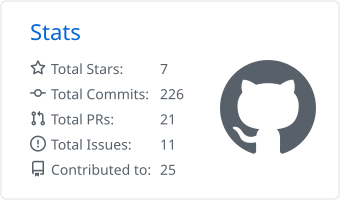
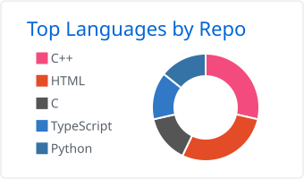
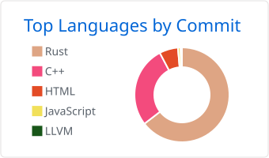
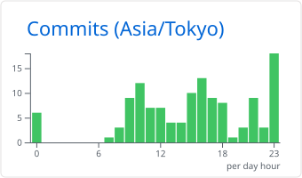

<picture>
  <source media="(prefers-color-scheme: dark)" srcset="https://capsule-render.vercel.app/api?type=waving&height=180&section=header&color=0:1f6feb,100:6e40c9&text=OHNope&fontColor=ffffff&fontSize=56&fontAlignY=38">
  
</picture>

<picture>
  <source media="(prefers-color-scheme: dark)" srcset="https://readme-typing-svg.demolab.com?font=Fira+Code&size=20&pause=1200&center=true&vCenter=true&width=520&height=40&color=58A6FF&lines=Based+in+Tokyo;Embedded+%26+PCB+design;C%2B%2B+and+Rust;Automating+KiCad+with+agents">
  
</picture>

## 👋 About me

I'm based in Tokyo, working somewhere between electronics and systems programming. I'm on the electrical team (電装班) at **Avi CREATE**, I develop school software (**isctCompanion**), I design small ESP32 camera boards in KiCad, and I write C++ and Rust. A lot of my time goes into making design and PCB workflows easier to automate, for people and for coding agents alike.

## 🔭 What I work on

- **Avi CREATE:** electrical team (電装班), hands-on hardware.
- **School software:** developing isctCompanion.
- **Hardware:** KiCad boards around the ESP32-P4 and ESP32-S3, mostly camera hardware: a MIPI CSI adapter board reworked for the SC035HGS sensor, and a XIAO ESP32-S3 Sense selfie camera with CAN and trigger I/O.
- **Design automation:** a shared KiCad release pipeline (ERC/DRC, GitHub Releases), a kit that keeps design docs in the repo for both reviewers and agents, and ongoing experiments with KiCad automation and MCP tooling.
- **Languages and tools:** a C++26 library that puts tensor shapes into the type system, a Rust tool for printing to a shared network printer, and assorted C++ utilities from earlier years.
- **Learning:** Stanford CS336 (language modeling from scratch), compilers (LLVM) and WebAssembly runtimes.

## 📌 Featured projects

| Project | What it is | |
|---|---|---|
| [**design-docs-kit**](https://github.com/OHNope/design-docs-kit) | Keep design docs in your git repo: a VitePress site people review, `AGENTS.md` rules and an MCP server agents use, a checker and a safe sync hook. |   |
| [**Typetorch**](https://github.com/OHNope/Typetorch) | Type-safe LibTorch tensor wrappers for C++26. Shape, dtype and layout mismatches are compile errors. |   |
| [**InstitutePrinter**](https://github.com/OHNope/InstitutePrinter) | Rust tool that sets up printing to a shared network printer from any app on your computer. |   |
| [**ESP32-P4X_MIPI_Camera_Sub_V1.1_KiCAD**](https://github.com/OHNope/ESP32-P4X_MIPI_Camera_Sub_V1.1_KiCAD) | KiCad conversion of Espressif's MIPI camera sub-board for the ESP32-P4 function board. |   |
| [**kicad-release**](https://github.com/OHNope/kicad-release) | Reusable KiCad release workflow: KiBot ERC/DRC, GitHub Releases, Google Drive. |   |

Also: [sc035hgs-esp32-p4x-camera-adapter-mod](https://github.com/OHNope/sc035hgs-esp32-p4x-camera-adapter-mod) (camera adapter rework), [seeed-xiao-studio-nose-camera](https://github.com/OHNope/seeed-xiao-studio-nose-camera) (XIAO selfie camera schematic), [RayTrace](https://github.com/OHNope/RayTrace) (a small C++ ray tracer).

## 🛠 Tech

<picture>
  <source media="(prefers-color-scheme: dark)" srcset="https://skillicons.dev/icons?i=rust,cpp,c,py,ts,js,html,cmake,arduino,latex,git,linux,vscode&theme=dark">
  
</picture>

## 📊 Stats

<picture>
  <source media="(prefers-color-scheme: dark)" srcset="https://raw.githubusercontent.com/OHNope/OHNope/main/profile-summary-card-output/github_dark/3-stats.svg">
  
</picture>
<picture>
  <source media="(prefers-color-scheme: dark)" srcset="https://raw.githubusercontent.com/OHNope/OHNope/main/profile-summary-card-output/github_dark/1-repos-per-language.svg">
  
</picture>

<picture>
  <source media="(prefers-color-scheme: dark)" srcset="https://raw.githubusercontent.com/OHNope/OHNope/main/profile-summary-card-output/github_dark/2-most-commit-language.svg">
  
</picture>
<picture>
  <source media="(prefers-color-scheme: dark)" srcset="https://raw.githubusercontent.com/OHNope/OHNope/main/profile-summary-card-output/github_dark/4-productive-time.svg">
  
</picture>

## 🐍 Contributions

<picture>
  <source media="(prefers-color-scheme: dark)" srcset="https://raw.githubusercontent.com/OHNope/OHNope/output/github-contribution-grid-snake-dark.svg">
  
</picture>

<picture>
  <source media="(prefers-color-scheme: dark)" srcset="https://capsule-render.vercel.app/api?type=waving&height=100&section=footer&color=0:1f6feb,100:6e40c9&text=&reversal=true&fontColor=ffffff">
  
</picture>

